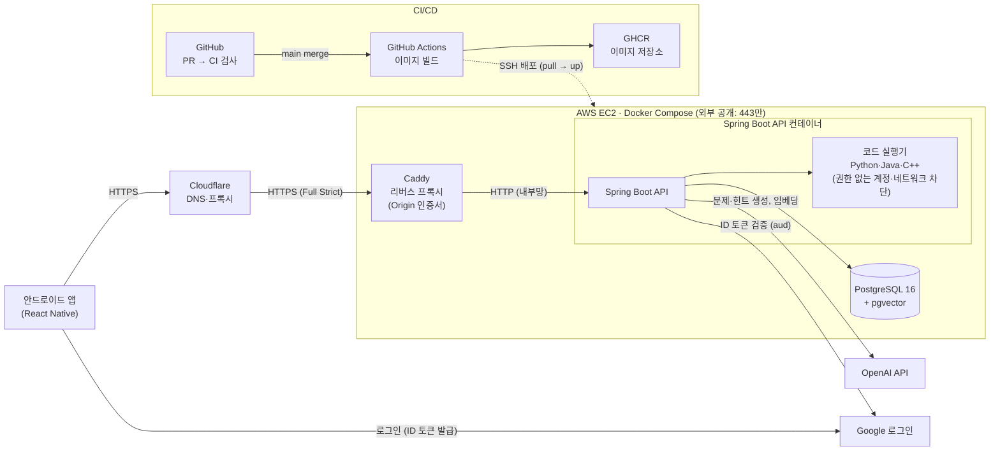

# 하루코딩 (Haru Coding)

매일 조금씩 코딩 테스트를 준비하는 안드로이드 앱입니다.
AI가 사용자의 약점에 맞춰 문제를 만들고, 서버가 코드를 실제로 실행해 채점합니다.

## 주요 기능

| 기능 | 내용 |
|---|---|
| 오늘의 문제 | 하루 목표(4~10문제)만큼 세트를 시작합니다. 절반은 약점 분류의 안 푼 문제, 나머지는 추천 문제이고, 모자라면 AI가 바로 만듭니다. |
| 문제 유형 | 구현(핵심 몇 줄 작성), 디버깅(틀린 부분 고치기), 빈칸 채우기. 언어는 Python·Java·C++ |
| 채점 | 예시 입출력과 숨겨진 테스트로 채점합니다. 오답이면 이유(컴파일 오류, 실행 오류, 시간 초과, 출력 차이)를 보여 줍니다. |
| AI 힌트 | 문제마다 3단계 힌트(방향 → 구체적 → 코드 구조) |
| 학습 통계 | 기간별(전체·주간·월간·연간) 풀이 수와 정답률, 월간 달력, 연간 히트맵, 유형별·난이도별 정답률, 약점 분류 |
| 그 밖에 | 온보딩 추천, 리그, 스크랩, 오답 노트, 알림, 다크 모드·글자 크기 |

난이도는 입문·초급·중급 3단계이고, 프로그래머스 Lv.0~2에 해당합니다.

## 아키텍처



- 서버는 AWS EC2 한 대에서 Docker Compose로 Caddy, API, DB 컨테이너를 띄웁니다. 외부에는 443 포트만 열려 있고, 요청은 Cloudflare와 Caddy를 거쳐서만 API에 들어옵니다.
- Cloudflare와 Caddy 사이도 HTTPS입니다(Full Strict, Cloudflare Origin 인증서). Caddy와 API는 컨테이너 내부망으로 연결되며, API와 DB는 외부에 포트를 열지 않습니다.
- 코드 실행기는 별도 서버가 아니라 API 컨테이너 안에서 돌고, 사용자 코드는 권한 없는 계정(`coderunner`)으로 네트워크 차단·자원 제한을 걸고 실행합니다.
- 힌트는 문제를 생성할 때 함께 만들어 저장합니다. 힌트를 볼 때 OpenAI를 다시 호출하지 않습니다.
- 구글 로그인은 앱이 받은 ID 토큰을 서버가 Google에 확인하고, 우리 앱용 토큰(`aud`)인지까지 검증합니다.
- 문제 추천은 문제 임베딩(pgvector) 유사도와 풀이 기록으로 고릅니다.

## 기술 스택

| 구분 | 사용 기술 |
|---|---|
| 앱 | React Native 0.85, TypeScript, React Navigation 7 |
| 서버 | Java 17, Spring Boot 3.5, Spring Security(JWT), Spring Data JPA |
| DB | PostgreSQL 16, pgvector |
| AI | OpenAI API(문제 생성, 임베딩 text-embedding-3-small) |
| 배포 | AWS EC2, Docker Compose, Caddy, Cloudflare, GitHub Actions, GHCR |

## 폴더 구조

```
backend/    Spring Boot 서버 (자세한 내용: backend/README.md)
frontend/   React Native 앱 (자세한 내용: frontend/README.md)
```

## 로컬에서 실행하기

### 1. 서버

```bash
cd backend
cp .env.example .env        # 값 채우기 (항목 설명은 .env.example 주석 참고)
docker compose -p harucoding up -d --build
```

- API는 `http://localhost:8080`, DB는 `localhost:5433`입니다.
- 처음 켤 때 시드 문제 247개와 임베딩을 적재합니다. `OPENAI_API_KEY`가 없거나 틀리면 문제 은행이 비어 있게 됩니다.
- `JWT_SECRET`, `ENCRYPTION_SECRET_KEY`, `DB_PASSWORD`가 비어 있으면 서버가 시작되지 않습니다.

### 2. 앱 (안드로이드 에뮬레이터)

```bash
cd frontend
npm install
npm start          # Metro
npm run android    # 다른 터미널에서 빌드·설치
```

에뮬레이터는 `http://10.0.2.2:8080`으로 같은 PC의 서버에 접속합니다.

## 배포

| 항목 | 내용 |
|---|---|
| 서버 주소 | `https://haru.careerpilot.kr` |
| 구성 | Cloudflare(DNS·프록시) → Caddy(리버스 프록시) → Spring Boot API → PostgreSQL. AWS EC2 한 대에서 Docker Compose로 실행 |
| 서버 설정 파일 | `deploy/docker-compose.yml`, `deploy/caddy/Caddyfile` (서버 `~/haru/`에 그대로 둡니다) |
| 환경변수 | 서버 `~/haru/.env`에 넣습니다. 항목은 `deploy/.env.example`을 참고합니다. |
| CI | main으로 가는 PR마다 GitHub Actions가 검사합니다 (백엔드 테스트·Docker 빌드, 프론트 lint·타입 검사·테스트) |
| 배포 | main에 `backend/` 변경이 merge되면 GitHub Actions가 이미지를 빌드해 GHCR에 올리고, SSH로 서버에서 새 이미지를 받아 API를 다시 띄웁니다. 수동 실행: Actions → Deploy Backend → Run workflow |
| 앱 빌드 | 릴리스 빌드는 `frontend/.env`의 `API_BASE_URL`이 비어 있으면 운영 서버로 붙습니다. 개발 빌드로 운영 서버를 쓰려면 `API_BASE_URL=https://haru.careerpilot.kr` |
| 앱 배포 (APK) | `app-v1.0.0` 같은 태그를 push하면 GitHub Actions가 APK를 빌드해 GitHub Release에 첨부합니다. 수동 실행: Actions → Build Android APK → Run workflow (Artifacts에 90일 보관). 저장소 Secret `GOOGLE_WEB_CLIENT_ID`가 필요합니다. 서버만 바뀐 경우엔 APK를 다시 만들 필요가 없습니다. |

- Cloudflare는 100초 안에 응답이 없으면 오류(524)를 돌려줍니다. 서버는 외부 호출 시간 제한과 문제 생성 재시도 제한으로 이 시간 안에 응답합니다.
- 운영 서버는 외부에 443만 엽니다. API는 호스트 포트를 열지 않고(Caddy가 내부망으로 연결), DB는 서버 안(127.0.0.1)에서만 접속됩니다.
- `deploy/` 파일(compose, Caddyfile)은 배포 워크플로가 서버로 옮기지 않으므로, 바꾸면 서버에 직접 반영합니다.

## 문서

- ERD: `backend/docs/erd.dbml` (dbdiagram.io에 붙여 넣어 볼 수 있습니다)
- 기능 정의서, API 정의서: 팀 노션
