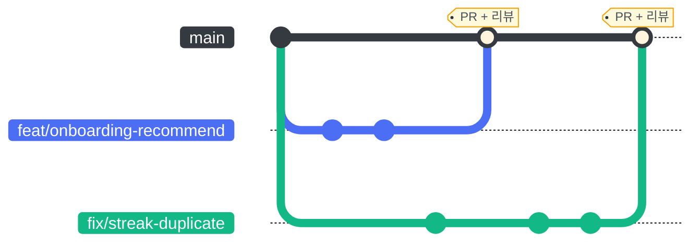

# 하루코딩 팀 컨벤션

> 목적: 코드의 통일성을 유지하여 가독성을 높이고, 협업 시 발생하는 혼란을 줄인다.
> 규칙은 최소한으로 유지하고, 필요할 때만 추가한다.

## 문서 이력

| 버전 | 날짜 | 작성자 | 변경 내용 |
|------|------|--------|----------|
| v1.0 | 2026-07-12 | 김태영 | 최초 작성 (커밋 메시지·네이밍·브랜치·주석 규칙) |

---

## 1. Git 커밋 메시지

[Conventional Commits](https://www.conventionalcommits.org/ko/) 표준을 따른다.

### 형식

```
타입: 요약 (한글 또는 영문 50자 이내)

(선택) 한 줄 비우고 상세 설명
```

### 타입

| 타입 | 언제 사용 |
|------|----------|
| `feat` | 기능 추가 |
| `fix` | 버그 수정 (잘못된 동작을 바로잡는 것) |
| `refactor` | 동작이 바뀌지 않는 코드 정리 |
| `build` | 빌드 파일, 모듈(의존성) 설치·수정 — gradle, package.json, Dockerfile 등 |
| `docs` | 문서(README 등)/주석만 수정 |
| `test` | 테스트 코드 |
| `chore` | 위에 해당하지 않는 자잘한 수정 |

### 예시

```
feat: 온보딩 난이도 추천 API 추가
fix: 스트릭 날짜 중복 저장 버그 수정
refactor: 난이도 문자열을 enum으로 통일
build: langchain4j 0.36.2로 버전 고정
```

### 하지 말 것

- ❌ `수정`, `업데이트`, `asdf` 같은 타입 없는 메시지
- ❌ 여러 작업을 커밋 하나에 몰아넣기 (기능 추가 + 버그 수정 → 커밋 2개로 분리)

---

## 2. 네이밍

**원칙: 프로젝트 통일 규칙을 새로 만들지 않고, 각 언어의 표준을 따른다.**

| 대상 | 규칙 | 예시 |
|------|------|------|
| Java / TypeScript 변수·함수 | camelCase | `streakDays`, `estimateLevel()` |
| Java / TypeScript 클래스·컴포넌트 | PascalCase | `ProblemService`, `HomeScreen` |
| 상수 | UPPER_SNAKE_CASE | `MAX_RETRY_COUNT` |
| DB 테이블·컬럼 | snake_case | `user_streak_logs`, `streak_days` |
| Java 패키지 | 전부 소문자 | `com.besenior.harucoding.dto` |
| 파일/폴더 (프론트) | 컴포넌트는 PascalCase, 그 외 camelCase | `HomeScreen.tsx`, `apiFetch.ts` |
| 파일 (백엔드 Java) | 파일명 = public 클래스명 (컴파일러가 강제하므로 별도 규칙 불필요) | `ProblemService.java` |
| Git 레포 | kebab-case | `haru-coding-backend` |
| Git 브랜치 | `타입/kebab-case` | `feat/onboarding-recommend` |

> DB(snake_case) ↔ Java(camelCase) 변환은 JPA가 자동으로 해준다.
> 예: 엔티티 필드 `streakDays` ↔ 컬럼 `streak_days`

---

## 3. 브랜치

**원칙: `main`은 항상 "동작하는 완성본". 작업은 각자 브랜치에서.**

1. `main`에 직접 push 금지 — 모든 변경은 PR(Pull Request)로만
2. 브랜치는 **작업 1개당 1개** (사람 이름 ❌, 작업 내용 ⭕)
3. 브랜치 이름: `타입/작업내용` — 타입은 커밋 타입과 동일한 단어 사용
4. merge 전에 **다른 팀원 1명의 승인(리뷰)** 필수
5. merge 후 브랜치는 삭제

### 작업 흐름



① `main`에서 작업 브랜치를 딴다 → ② 내 브랜치에서 자유롭게 커밋 (미완성이어도 OK, 서로 안 섞임) →
③ 완성되면 PR을 열고, 팀원 승인 후 `main`에 merge → 브랜치 삭제

### 브랜치 이름 예시

```
✅ feat/onboarding-recommend
✅ fix/streak-duplicate
✅ refactor/difficulty-enum
❌ jin, yoon, eunju        (누구인지는 GitHub이 알려줌)
❌ feat/작업1              (뭘 하는지 알 수 없음)
```

---

## 4. 주석

1. **public 메서드/클래스에는 한 줄 요약 필수** (Java는 `/** */`, TS는 `//`)
   - 타입만으로 알 수 없는 **사용법 예시·주의사항**이 있으면 추가한다.
2. **private/간단한 함수는 생략 OK** — 이름으로 충분하면 안 단다.
3. **"무엇(what)" 주석 금지, "왜(why)"만** — 코드가 바뀌면 주석은 안 고쳐져서 거짓말하는 주석이 되기 때문.

```java
// ❌ 나쁨: 코드 읽으면 아는 내용 (무엇)
// 유저를 찾아서 스트릭을 1 증가시킨다
user.increaseStreak();

// ⭕ 좋음: 코드만 봐선 알 수 없는 이유 (왜)
// create면 재시작마다 테이블이 날아가므로 update 사용
spring.jpa.hibernate.ddl-auto=update
```

```java
/**
 * 컬럼 정의(Map)로 테이블을 생성한다.
 * columns 예시: {"id": "INTEGER PRIMARY KEY", "name": "TEXT NOT NULL"}
 * dropIfExists가 true면 기존 테이블을 먼저 삭제한다.  ← 위험 동작은 반드시 명시
 */
public void createTable(String table, Map<String, String> columns, boolean dropIfExists)
```

